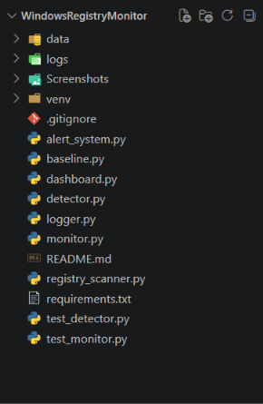
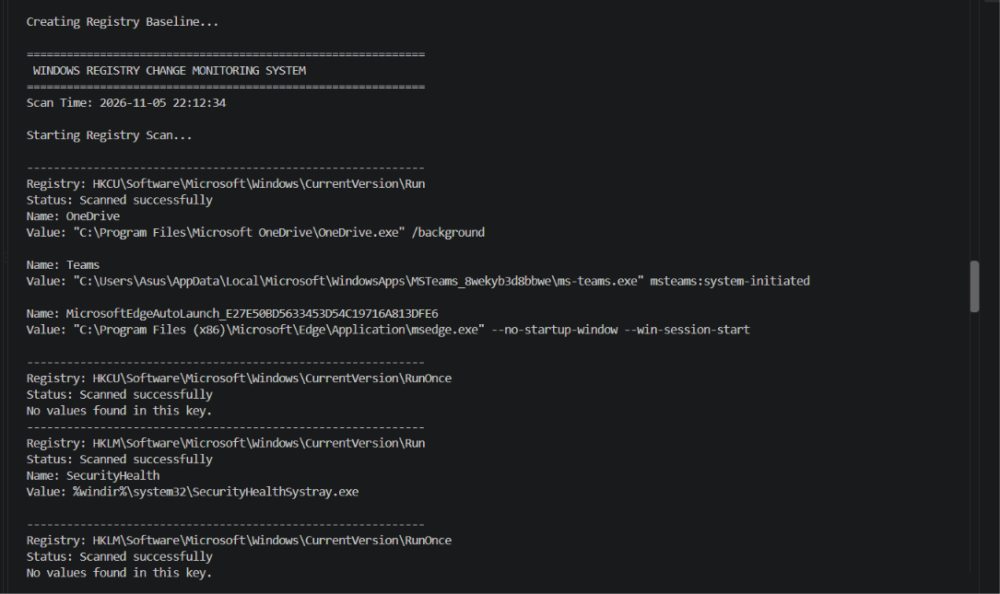
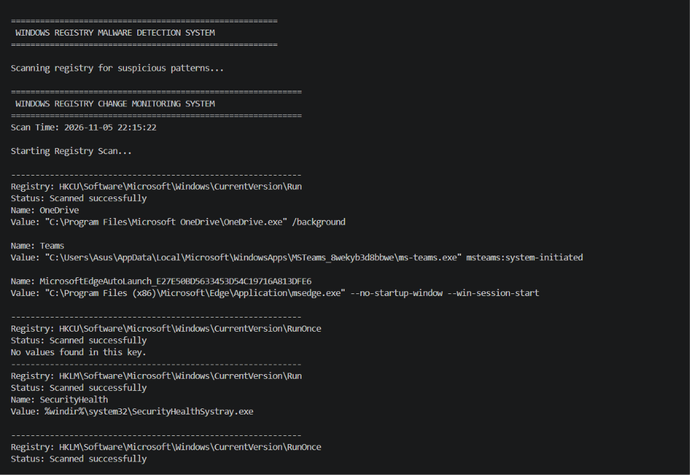
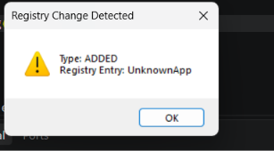
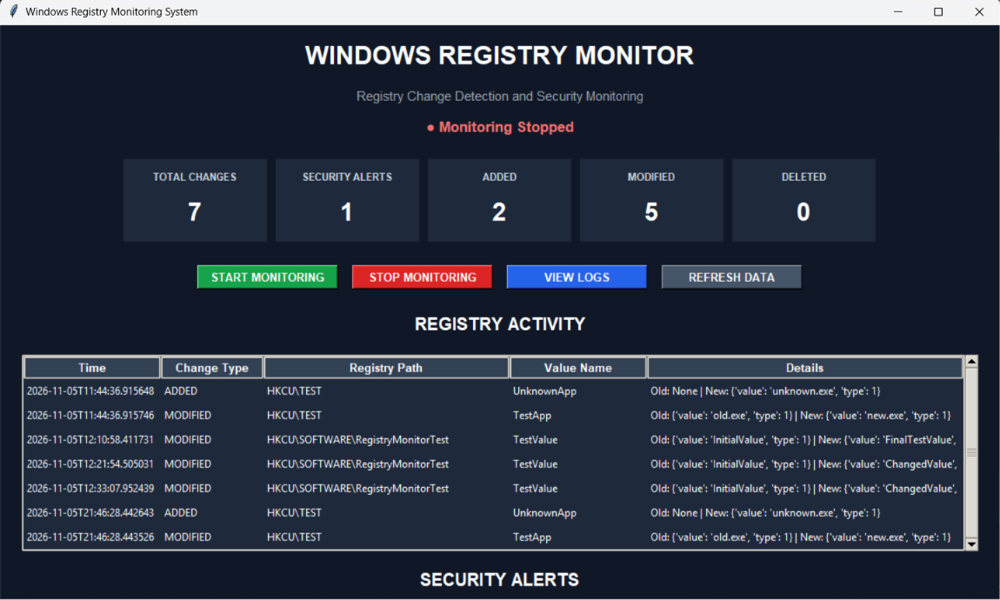
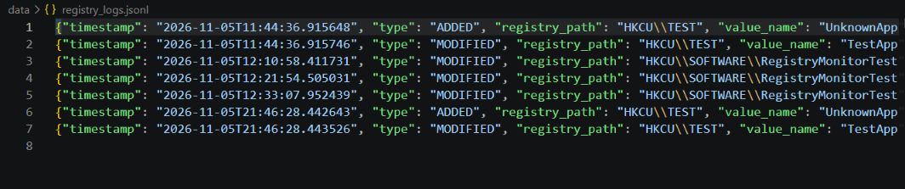

# Windows Registry Change Monitoring System

A Python-based cybersecurity project that monitors Windows Registry changes and detects suspicious or unauthorized modifications.

## Project Overview

The Windows Registry stores important configuration settings related to the operating system, applications, startup programs, and security policies.

This project monitors selected registry locations, compares current registry data with a saved baseline, detects changes, and generates security alerts.

## Features

- Windows Registry Scanning
- Registry Baseline Creation
- Registry Integrity Checking
- Added Entry Detection
- Deleted Entry Detection
- Modified Value Detection
- Autorun Registry Monitoring
- Suspicious Activity Detection
- Security Alert Generation
- Timestamped Logging
- Monitoring Dashboard

## Technologies Used

- Python
- Flask
- Windows Registry (winreg)
- JSON and JSONL
- Hashlib
- HTML
- CSS

## Project Structure

```text
WindowsRegistryMonitor/
│
├── data/
│   ├── alerts.jsonl
│   ├── baseline.json
│   └── registry_logs.jsonl
│
├── logs/
├── screenshots/
│
├── alert_system.py
├── baseline.py
├── dashboard.py
├── detector.py
├── logger.py
├── monitor.py
├── registry_scanner.py
├── test_detection.py
│
├── README.md
├── requirements.txt
└── .gitignore
```

## Installation

### 1. Clone the Repository

```bash
git https://github.com/dikshasharma-25/Window-Registry-Monitor.git
```

### 2. Navigate to Project Directory

```bash
cd Window-Registry-Monitor
```

### 3. Create Virtual Environment

```bash
python -m venv venv
```

### 4. Activate Virtual Environment

```powershell
venv\Scripts\activate
```

### 5. Install Dependencies

```bash
pip install -r requirements.txt
```

## Usage

### Run Registry Scanner

```bash
python registry_scanner.py
```

### Create Registry Baseline

```bash
python baseline.py
```

### Run Detection Tests

```bash
python test_detector.py
```

### Start Registry Monitoring

```bash
python monitor.py
```

### Run Dashboard

```bash
python dashboard.py
```

Note: Run commands according to the execution flow implemented in each module.

## Screenshots

### Project Structure



### Baseline Creation



### Detection Testing



### Security Alerts



### Dashboard



### Registry Logs



## Testing

The project includes a detection testing module to verify:

- Registry entry additions
- Registry entry deletions
- Registry value modifications
- Suspicious registry patterns

## Learning Outcomes

- Understanding Windows Registry structure
- Learning registry-based malware persistence techniques
- Implementing baseline comparison
- Detecting suspicious registry modifications
- Developing Python security monitoring tools
- Understanding Blue Team security operations

## Future Improvements

- Real-time registry monitoring
- Advanced threat detection
- Email notifications
- Automated security reports
- Improved dashboard analytics

## Disclaimer

This project is developed for educational and defensive cybersecurity purposes.

It is intended for monitoring registry changes on authorized Windows systems only.

## Author

**Diksha Sharma**

BCA Student | Cybersecurity Enthusiast

GitHub: https://github.com/dikshasharma-25
